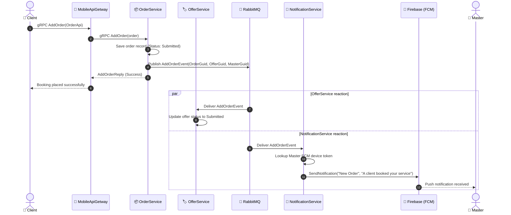
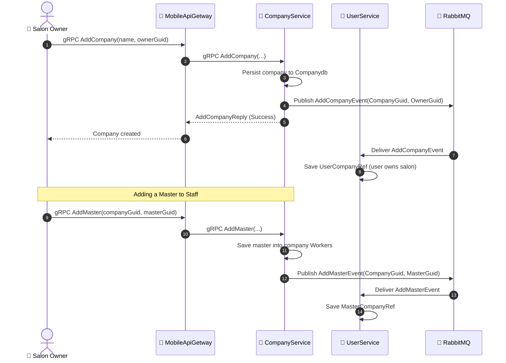

# 🚀 BeautyLink Microservices BackEnd

[](https://dotnet.microsoft.com/)
[](https://grpc.io/)
[](https://www.rabbitmq.com/)
[](https://www.postgresql.org/)
[](https://www.docker.com/)
[](#)

[English](README_en.md) | [Русский](README.md)

---

A high-performance **microservices backend** (.NET 9 / C# 13) powering the **BeautyLink** platform — an online booking and management system connecting beauty masters, salons (companies), and clients.

The system is built on **Event-Driven Architecture (EDA)** principles utilizing **RabbitMQ** for asynchronous messaging, high-throughput **gRPC** for internal synchronous RPC, a centralized **API Gateway (BFF)**, and the **Database-per-Service** pattern backed by **PostgreSQL 17**.

---

## 📑 Table of Contents

1. [Architecture Overview](#-architecture-overview)
2. [Technology Stack](#-technology-stack)
3. [Project Structure](#-project-structure)
4. [Microservices Breakdown](#-microservices-breakdown)
5. [Inter-Service Communication](#-inter-service-communication)
   - [Synchronous Communication (gRPC)](#1-synchronous-communication-grpc)
   - [Asynchronous Event Bus (RabbitMQ)](#2-asynchronous-event-bus-rabbitmq)
   - [Event Matrix](#3-event-matrix)
   - [Sequence Diagrams](#4-sequence-diagrams)
6. [Data Persistence & Database-per-Service](#-data-persistence--database-per-service)
7. [Network Configuration & Port Mapping](#-network-configuration--port-mapping)
8. [Getting Started & Run Guide](#-getting-started--run-guide)
   - [Running with Docker Compose (Recommended)](#running-with-docker-compose-recommended)
   - [Local Development (Out-of-Docker)](#local-development-out-of-docker)
9. [API Testing & Debugging](#-api-testing--debugging)
   - [gRPC with Kreya](#1-testing-grpc-with-kreya-recommended)
   - [Auth REST Endpoints (cURL)](#2-testing-auth-rest-endpoints)
10. [Key Architectural Decisions](#-key-architectural-decisions)

---

## 🏛 Architecture Overview

The system is designed as a distributed cluster of autonomous, loosely coupled microservices:

```mermaid
flowchart TD
    Client["📱 Clients (Mobile / Web SPA / Admin)"]

    subgraph Ingress ["Ingress & Authentication"]
        Gateway["🚪 MobileApiGetway\n(gRPC Gateway / BFF, :6000)"]
        AuthService["🔐 Auth Service\n(:6007 gRPC / :6008 REST)"]
    end

    subgraph CoreServices ["Core Domain Services (gRPC HTTP/2)"]
        UserService["👤 UserService (:6001)"]
        CompanyService["🏢 CompanyService (:6002)"]
        SkillService["✂️ SkillService (:6003)"]
        OfferService["🏷️ OfferService (:6004)"]
        OrderService["📦 OrderService (:6005)"]
        NotificationService["🔔 NotificationService (:6006)"]
        LocationService["📍 LocationService"]
    end

    subgraph Messaging ["Message Broker (Event-Driven)"]
        RabbitMQ[("🐇 RabbitMQ\nExchange: eshop_event_bus\n(:5672, UI :15672)")]
    end

    subgraph Persistence ["Isolated Databases (Database-per-Service)"]
        Postgres[("🐘 PostgreSQL 17 (:5432)\nauthdb | Userdb | Companydb\nOfferdb | Orderdb | Skilldb\nNotificationdb")]
    end

    subgraph ExternalServices ["External Providers"]
        FCM["📲 Firebase Cloud Messaging (FCM)"]
        GoogleAuth["🌐 Google OAuth 2.0"]
    end

    %% Client Links
    Client -->|"gRPC"| Gateway
    Client -->|"REST /auth/*"| AuthService

    %% Gateway to Internal Services (gRPC)
    Gateway -->|"gRPC Client"| AuthService
    Gateway -->|"gRPC Client"| UserService
    Gateway -->|"gRPC Client"| CompanyService
    Gateway -->|"gRPC Client"| SkillService
    Gateway -->|"gRPC Client"| OfferService
    Gateway -->|"gRPC Client"| OrderService
    Gateway -->|"gRPC Client"| NotificationService
    Gateway -->|"gRPC Client"| LocationService

    %% Event Bus Integration
    UserService <-->|"Publish / Subscribe"| RabbitMQ
    CompanyService <-->|"Publish / Subscribe"| RabbitMQ
    SkillService <-->|"Publish / Subscribe"| RabbitMQ
    OfferService <-->|"Publish / Subscribe"| RabbitMQ
    OrderService <-->|"Publish / Subscribe"| RabbitMQ
    NotificationService <-->|"Subscribe"| RabbitMQ
    LocationService <-->|"Subscribe"| RabbitMQ

    %% Database Links
    AuthService -->|"EF Core"| Postgres
    UserService -->|"EF Core"| Postgres
    CompanyService -->|"EF Core"| Postgres
    SkillService -->|"EF Core"| Postgres
    OfferService -->|"EF Core"| Postgres
    OrderService -->|"EF Core"| Postgres
    NotificationService -->|"EF Core"| Postgres

    %% External Links
    NotificationService -->|"Push Notifications"| FCM
    AuthService -->|"Token Verification"| GoogleAuth
```



### Core Architectural Patterns:
- **API Gateway / Backend-For-Frontend (BFF)**: `MobileApiGetway` acts as a single point of entry for clients, encapsulating internal topology and aggregating responses (e.g., retrieving a master's full profile along with associated salons and active offers).
- **Event-Driven Architecture (EDA)**: Asynchronous event bus via RabbitMQ ensures loose coupling and eventual consistency across domains.
- **Database-per-Service**: Each microservice maintains its own relational schema and database, eliminating shared database state.
- **CQRS & MediatR**: The `Auth` service segregates commands and queries using `MediatR` alongside `FluentValidation` and `FluentResults`.

---

## 🛠 Technology Stack

| Layer / Role | Technology | Description |
|---|---|---|
| **Runtime & Language** | [.NET 9.0](https://dotnet.microsoft.com/) / C# 13 | High-performance server runtime and modern language features |
| **RPC Framework** | [gRPC](https://grpc.io/) / [Protobuf 3](https://protobuf.dev/) | Compact, high-throughput binary RPC protocol over HTTP/2 |
| **REST API** | ASP.NET Core Controllers | REST endpoints with CORS for browser-based single-page apps (SPAs) |
| **Message Broker** | [RabbitMQ](https://www.rabbitmq.com/) (AMQP 0-9-1) | Reliable messaging broker for integration events |
| **Resilience** | [Polly](https://github.com/App-vNext/Polly) | Exponential backoff retry policies for connection and publishing faults |
| **Database** | [PostgreSQL 17](https://www.postgresql.org/) (Alpine) | Robust relational database management system |
| **ORM / Data Access** | [EF Core 9](https://learn.microsoft.com/ef/core/) / [Npgsql](https://www.npgsql.org/) | Entity Framework Core provider with automated schema provisioning |
| **DI Container** | [Autofac](https://autofac.org/) | Advanced lifetime scopes and dynamic event handler resolution |
| **Security & IAM** | ASP.NET Core Identity + JWT Bearer | Password hashing, access/refresh tokens with database rotation |
| **OAuth 2.0** | Google.Apis.Auth | Secure Google Sign-In with server-side `idToken` verification |
| **Push Notifications** | [Firebase Admin SDK](https://firebase.google.com/docs/admin/setup) | Cross-platform mobile notifications via FCM |
| **Logging** | [Serilog](https://serilog.net/) | Structured logging to console and configuration sinks |
| **Containerization** | [Docker](https://www.docker.com/) / Docker Compose | Containerization and multi-container orchestration |
| **Testing Tools** | [Kreya](https://kreya.app/) / pgAdmin 4 | gRPC GUI client workspace and database management UI |

---

## 📁 Project Structure

```
BackEnd/
├── Auth/                   # Identity and Access Management (gRPC + REST)
│   ├── Controllers/        # REST endpoints (/auth/*) for web/SPA clients
│   ├── Data/               # AuthDbContext (Identity, RefreshTokens)
│   ├── MediatR/            # CQRS commands, queries, and handlers
│   ├── Models/             # User and RefreshToken entities, DTOs
│   └── Services/           # gRPC implementation (AuthServiceImp), JWT, Google OAuth
├── MobileApiGetway/        # Central API Gateway (gRPC BFF)
│   └── Services/           # MobileApiService (routing and data aggregation)
├── UserService/            # User profiles, masters, and relationship records
│   ├── EventHandlers/      # Company and offer event handlers
│   ├── Models/             # User, UserCompanyRef, MasterCompanyRef, UserOfferRef
│   └── Services/           # UserServiceImp (gRPC) and repository layer
├── CompanyService/         # Salons/companies management and master assignments
│   ├── EventHandlers/      # DelUser and offer event handlers
│   ├── Models/             # Company, CompanyUserRef, CompanyOfferRef
│   └── Services/           # CompanyServiceImp (gRPC) and repository layer
├── SkillService/           # Skill and service category catalog
│   ├── Models/             # Skill entity (name, description)
│   └── Services/           # SkillServiceImp (gRPC)
├── OfferService/           # Master service offerings (Offers)
│   ├── EventHandlers/      # Orders, companies, and geo-coordinate sync handlers
│   ├── Models/             # Offer (Master + Company + Skill + Order linkage)
│   └── Services/           # OfferServiceImp (gRPC)
├── OrderService/           # Customer booking orders and state machine
│   ├── EventHandlers/      # Offer and user deletion event handlers
│   ├── Models/             # Order entity and OrderStatus enum
│   └── Services/           # OrderServiceImp (gRPC)
├── NotificationService/    # Mobile push notification dispatch via Firebase (FCM)
│   ├── EventHandlers/      # Order creation and lifecycle change handlers
│   ├── Models/             # User-to-FCM-token registry (NotificationUser)
│   └── Services/           # MobileMessagingService (Firebase integration)
├── LocationService/        # User geo-coordinate tracking (Lat / Lng)
├── EventBus/               # Reusable RabbitMQ Event Bus class library
│   ├── Abstractions/       # IEventBus, IIntegrationEventHandler interfaces
│   ├── EventBusRabbitMQ/   # Persistent connections, channels, Polly retry policies
│   ├── Events/             # Strongly typed integration event definitions
│   └── SubscriptionsManager/# Subscription routing and registration logic
├── Globals/                # Shared base classes and middleware
│   ├── Abstractions/       # IRepoServiceBase
│   ├── Models/             # ContextBase<T>, EntityBase, RefBase<T>
│   └── Sevices/            # Generic RepoServiceBase<T> implementation
├── BackEndKrey/            # Ready-to-use Kreya workspace for gRPC testing
├── docker-compose.yml      # Orchestration file for containers, networks, and volumes
├── docker-compose.override.yml
├── servers.json            # Auto-registration config for PostgreSQL in pgAdmin
└── BackEnd.sln             # Visual Studio / .NET CLI solution file
```

In the root folder (one level above `BackEnd/`):
- `Protos/` — Single source of truth: `.proto` contracts for gRPC (`mobile_api.proto`, `user.proto`, `company.proto`, `offer.proto`, `order.proto`, `skill.proto`, `auth.proto`, `notification.proto`).

---

## 🧩 Microservices Breakdown

### 1. `MobileApiGetway` (Port: `6000`)
- **Role**: API Gateway / Backend For Frontend (BFF).
- **Protocol**: gRPC (HTTP/2 cleartext).
- **Contract**: `mobile_api.proto` (`MobileApi`).
- **Key Responsibilities**:
  - Serves as the single client entry point for all mobile and web operations.
  - Transparently forwards requests to internal microservices.
  - Performs data aggregation: for instance, `GetMainDataForUser` collects user profile details, affiliated companies, staff members (masters), and all active offers per master in parallel.

### 2. `Auth` (Ports: `6007` gRPC / `6008` REST)
- **Role**: Identity and Access Management (IAM).
- **Storage**: Schema `auth` in database `authdb` (PostgreSQL).
- **Architecture**: CQRS via `MediatR`, `FluentResults`, `FluentValidation`.
- **Dual Interfaces**:
  - **REST API** (`/auth/*` on port `8080` / `6008`): register, login, Google OAuth login, logout, refresh token, change password. CORS enabled for Web SPAs.
  - **gRPC API** (`auth.proto` on port `80` / `6007`): high-speed authentication check for `MobileApiGetway`.
- **Security**:
  - Short-lived JWT Access Tokens (15 minutes).
  - Cryptographically secure, rotating Refresh Tokens stored in PostgreSQL.
  - Role-Based Access Control (RBAC): `MainAdministrator`, `Admin`, `Moderator`, `User`, `Guest`.

### 3. `UserService` (Port: `6001`)
- **Role**: User domain, master profiles, and cross-service relations.
- **Storage**: Database `Userdb`.
- **Key Responsibilities**:
  - User registration and retrieval.
  - Publishes user lifecycle events (`AddUserEvent`, `DelUserEvent`) to RabbitMQ.
  - Tracks cross-domain references: companies owned/joined (`UserCompanyRef`), master-company bindings (`MasterCompanyRef`), and offers (`UserOfferRef`).

### 4. `CompanyService` (Port: `6002`)
- **Role**: Salons, studios, companies, and staff rosters.
- **Storage**: Database `Companydb`.
- **Key Responsibilities**:
  - Create and delete company records with ownership (`OwnerGuid`).
  - Staff management: `AddMaster` (add master to company) and `DelMaster`.
  - Filter companies by relation: `owner` (owned by user), `contains` (user is a master), `canbecontains` (available to join).
  - Company geo-location coordinates (`Lat`, `Lng`).

### 5. `SkillService` (Port: `6003`)
- **Role**: Catalog of services and master skills (e.g., "Haircut", "Manicure", "Massage").
- **Storage**: Database `Skilldb`.
- **Key Responsibilities**: CRUD operations for service catalog entries.

### 6. `OfferService` (Port: `6004`)
- **Role**: Service offerings published by masters.
- **Storage**: Database `Offerdb`.
- **Key Responsibilities**:
  - Composes an offer binding a master (`MasterGuid`), company (`CompanyGuid`), and skill (`SkillGuid`).
  - Tracks offering status: `Actived` ➡️ `Submitted` ➡️ `Accepted`.
  - Coordinate synchronization: consumes `SendInfoForOffer` to update location coordinates from the company.

### 7. `OrderService` (Port: `6005`)
- **Role**: Booking orders placed by clients.
- **Storage**: Database `Orderdb`.
- **Key Responsibilities**:
  - Creation and management of customer orders for specific offers.
  - Order state machine:
    - `Submitted` — created by client, awaiting confirmation.
    - `Accepted` — confirmed by master/salon.
    - `Executed` — successfully completed.
    - `UnExecuted` — unfulfilled.
    - `Canceled` — cancelled.
  - Publishes lifecycle events consumed by notification and offer services.

### 8. `NotificationService` (Port: `6006`)
- **Role**: Real-time push notification center.
- **Storage**: Database `Notificationdb`.
- **Integration**: Google Firebase Cloud Messaging (FCM).
- **Key Responsibilities**:
  - Maps `UserGuid` to mobile device push tokens.
  - Listens to RabbitMQ order events to dispatch instant push notifications:
    - To Master: "New booking order received!".
    - To Client: "Your booking was accepted by the master" or "Service completed".

### 9. `LocationService`
- **Role**: Geo-coordinate registry (`Lat`, `Lng`) for users and service locations.

---

## 🔄 Inter-Service Communication

### 1. Synchronous Communication (gRPC)
Used whenever a client or service requires immediate, low-latency data:
- Internal gRPC services communicate via **HTTP/2 cleartext (h2c)**.
- `MobileApiGetway` injects strongly typed gRPC clients registered via `services.AddGrpcClient<TClient>`.
- Aggregation flow example:
  ```
  Client ➡️ MobileApiGetway ──(gRPC)──> UserService.GetUser()
                            ├──(gRPC)──> CompanyService.GetCompanies()
                            └──(gRPC)──> OfferService.GetOffers()
  ```

### 2. Asynchronous Event Bus (RabbitMQ)
Used to enforce Eventual Consistency without tight coupling:
- **Exchange**: `eshop_event_bus` (type: `direct`).
- **Routing Key**: Integration event type name (e.g., `AddOrderEvent`).
- **Queues**: Dedicated queue per microservice (`UserService`, `CompanyService`, `OfferService`, etc.).
- **Reliability**: Persistent delivery mode (`DeliveryMode = 2`). Polly retry policies handle temporary socket or broker disconnects using exponential backoff ($2^n$ seconds).
- **Dispatch**: Upon receipt, an Autofac child lifetime scope (`BeginLifetimeScope`) resolves and executes `IIntegrationEventHandler<T>`.

### 3. Event Matrix

| Event | Publisher | Subscribers | Action Performed |
|---|---|---|---|
| `AddUserEvent` | `UserService` | `LocationService`<br>`NotificationService` | Provisions location entry;<br>Registers user device token in FCM store |
| `DelUserEvent` | `UserService` | `CompanyService`<br>`OfferService`<br>`OrderService`<br>`NotificationService` | Removes worker from salons;<br>Revokes master offers;<br>Cancels active user orders;<br>Deletes push notification token |
| `AddCompanyEvent` | `CompanyService` | `UserService` | Records owner-to-company association (`UserCompanyRef`) |
| `DelCompanyEvent` | `CompanyService` | `UserService`<br>`OfferService` | Cleans up company relation;<br>Cascades deletion to company offers |
| `AddMasterEvent` | `CompanyService` | `UserService` | Records master employment (`MasterCompanyRef`) |
| `DelMasterEvent` | `CompanyService` | `UserService` | Removes master-company binding |
| `SendInfoForOffer` | `CompanyService` | `OfferService` | Propagates salon coordinates (`Lat`/`Lng`) to active offers |
| `AddOfferEvent` | `OfferService` | `UserService`<br>`CompanyService` | Stores offer references under master and salon records |
| `DelOfferEvent` | `OfferService` | `UserService`<br>`CompanyService`<br>`OrderService` | Removes offer references; cancels related pending orders |
| `AddOrderEvent` | `OrderService` | `OfferService`<br>`NotificationService` | Links order to target offer;<br>Dispatches FCM push notification to Master |
| `AcceptedOrderEvent` | `OrderService` | `NotificationService` | Sends FCM push notification to Client that booking was accepted |
| `ExecutedOrderEvent` | `OrderService` | `NotificationService` | Sends FCM push notification to Client that service was completed |
| `DelOrderEvent` | `OrderService` | `OfferService` | Disassociates order from offer |
| `AddSkillEvent` | `SkillService` | *(Extensible)* | Broadcasts new skill creation |
| `DelSkillEvent` | `SkillService` | *(Extensible)* | Broadcasts skill removal |

---

### 4. Sequence Diagrams

#### Scenario A: Order Placement & Push Notification Delivery



#### Scenario B: Company Registration & Master Assignment



---

## 💾 Data Persistence & Database-per-Service

The backend strictly adheres to the **Database-per-Service** pattern:
- A single PostgreSQL 17 cluster hosts multiple **independent databases**:
  - `authdb` (schema: `auth`) — ASP.NET Core Identity tables (`Users`, `Roles`, `UserRoles`, `RefreshTokens`).
  - `Userdb` — table `User` and relational mapping tables (`UserCompanyRef`, `MasterCompanyRef`, `UserOfferRef`).
  - `Companydb` — table `Company` and worker list (`CompanyUserRef`), offer list (`CompanyOfferRef`).
  - `Offerdb` — table `Offer` (service details, coordinates, status).
  - `Orderdb` — table `Order` (order lifecycle state and participant IDs).
  - `Skilldb` — table `Skill` (service catalog).
  - `Notificationdb` — table `NotificationUser` (FCM tokens).
- **Automated Provisioning**:
  - Derived from `Globals.Models.ContextBase<T>`, each service executes `Database.EnsureCreated()` on startup, automatically creating its dedicated database and tables.
  - The `Auth` service automatically seeds all default system roles using `RoleManager`.

---

## 🔌 Network Configuration & Port Mapping

| Service | Host Port | Container Port | Protocol | Purpose |
|---|---|---|---|---|
| **MobileApiGetway** | `6000` | `80` | gRPC (HTTP/2) | Central ingress gateway for clients |
| **UserService** | `6001` | `80` | gRPC (HTTP/2) | User domain and relationship management |
| **CompanyService** | `6002` | `80` | gRPC (HTTP/2) | Salons, companies, and master rosters |
| **SkillService** | `6003` | `80` | gRPC (HTTP/2) | Skill and category catalog |
| **OfferService** | `6004` | `80` | gRPC (HTTP/2) | Master service offerings |
| **OrderService** | `6005` | `80` | gRPC (HTTP/2) | Booking orders and state machine |
| **NotificationService** | `6006` | `80` | gRPC (HTTP/2) | Push notifications via Firebase (FCM) |
| **AuthService (gRPC)** | `6007` | `80` | gRPC (HTTP/2) | Internal gRPC authentication interface |
| **AuthService (REST)** | `6008` | `8080` | HTTP/1.1 (JSON) | REST API for browsers and SPAs |
| **PostgreSQL** | `5432` | `5432` | TCP | PostgreSQL 17 database cluster |
| **pgAdmin 4** | `5050` | `80` | HTTP | Web management dashboard for PostgreSQL |
| **RabbitMQ (AMQP)** | `5672` | `5672` | AMQP | Event bus broker communication port |
| **RabbitMQ (UI)** | `15672` | `15672` | HTTP | RabbitMQ Web Management Dashboard |

---

## 🚀 Getting Started & Run Guide

### Running with Docker Compose (Recommended)

This is the fastest and most reliable way to spin up the entire cluster:

#### 1. Prerequisites
- [Docker Desktop](https://www.docker.com/products/docker-desktop/) installed and running (with Compose v2).
- Ports `5050`, `5432`, `5672`, `15672`, `6000-6008` available.

#### 2. Start all services
Navigate to the `BackEnd` directory and start the build:

```powershell
cd D:\Projects\CV\BackEnd
docker compose up -d --build
```

#### 3. Verify container status
```powershell
docker compose ps
```
All services should report `Up`. Core business services automatically wait for the `rabbitmq` health check to pass.

#### 4. Access Administrative Web Consoles
- **RabbitMQ Management Dashboard**: [http://localhost:15672](http://localhost:15672)
  - **Username**: `guest`
  - **Password**: `guest`
  - *Inspect queues, exchange `eshop_event_bus`, bindings, and message throughput.*
- **pgAdmin 4**: [http://localhost:5050](http://localhost:5050)
  - **Email**: `admin@admin.com`
  - **Password**: `admin`
  - *PostgreSQL is pre-configured via `servers.json`. Database password: `postgres`.*

#### 5. Stop the containers
```powershell
docker compose down
```
*(To erase persistent volumes and reset databases, append `-v`: `docker compose down -v`)*

---

### Local Development (Out-of-Docker)

To run or debug specific microservices in Visual Studio, JetBrains Rider, or VS Code:

1. **Start only the infrastructure (PostgreSQL & RabbitMQ)**:
   ```powershell
   docker compose up -d postgres rabbitmq pgadmin
   ```
2. **Infrastructure endpoints will be available locally**:
   - PostgreSQL: `localhost:5432`
   - RabbitMQ: `localhost:5672`
3. **Run your service**:
   - In your IDE, select the target project or configure Multiple Startup Projects (`MobileApiGetway`, `Auth`, `UserService`).
   - Or run from the command line:
   ```powershell
   dotnet run --project MobileApiGetway/MobileApiGetway.csproj
   ```
4. Base classes `ContextBase<T>` and `EventBusService` automatically detect that they are executing outside of Docker and fall back to `localhost`.

---

## 🧪 API Testing & Debugging

### 1. Testing gRPC with Kreya (Recommended)

The repository includes a ready-to-use **Kreya** workspace in the `BackEndKrey/` directory:

1. Download and install [Kreya](https://kreya.app/downloads).
2. Open Kreya and click **"Open Project"**.
3. Select folder: `D:\Projects\CV\BackEnd\BackEndKrey`.
4. In the project tree, explore pre-configured requests:
   - `mobileApi/` — endpoints for `MobileApiGetway` (port 6000).
   - `user/`, `company/`, `offer/`, `order/`, `skill/`, `auth/` — direct microservice requests.
5. Select a request, populate parameters, and press **Send** (F5).

---

### 2. Testing Auth REST Endpoints

The `Auth` service exposes a REST API on port `6008`:

#### Register User:
```bash
curl -X POST http://localhost:6008/auth/register \
  -H "Content-Type: application/json" \
  -d '{
    "name": "Jane",
    "surname": "Doe",
    "email": "jane@example.com",
    "password": "Password123!",
    "passwordConfirmation": "Password123!"
  }'
```

#### Login:
```bash
curl -X POST http://localhost:6008/auth/login \
  -H "Content-Type: application/json" \
  -d '{
    "login": "jane@example.com",
    "password": "Password123!"
  }'
```
**Response:**
```json
{
  "token": "eyJhbGciOiJIUzI1NiIsInR5cCI6IkpXVCJ9...",
  "refreshToken": "d8a1c9e4-...",
  "expireAt": "2026-11-02T10:30:00Z",
  "user": {
    "id": 1,
    "name": "Jane",
    "surname": "Doe",
    "email": "jane@example.com",
    "role": "MainAdministrator"
  }
}
```

#### Refresh Token:
```bash
curl -X POST http://localhost:6008/auth/refresh-token \
  -H "Content-Type: application/json" \
  -d '{
    "refreshToken": "d8a1c9e4-..."
  }'
```

---

## 💡 Key Architectural Decisions

1. **Dual Endpoints in `AuthService` (HTTP/2 vs HTTP/1.1)**:
   - When serving cleartext HTTP (h2c), Kestrel cannot negotiate HTTP/1.1 and HTTP/2 on the same port.
   - Therefore, `Auth` listens on two distinct ports:
     - Port `80` (`http://+:80`, HTTP/2) — for internal gRPC communication from `MobileApiGetway`.
     - Port `8080` (`http://+:8080`, HTTP/1.1) — for web browsers and SPAs with CORS enabled (`http://localhost:5173`).
2. **Centralized Protobuf Schemas**:
   - Schema files `.proto` are centralized in the root `Protos/` directory and linked into individual `.csproj` files (`<Protobuf Include="..\..\Protos\*.proto" />`), ensuring a single source of truth across all services.
3. **Eventual Consistency over 2PC**:
   - Cross-domain operations do not rely on slow distributed transactions (Two-Phase Commit). Instead, services employ idempotent event handlers communicating over RabbitMQ.
4. **12-Factor App Environment Configuration**:
   - Connection parameters (`POSTGRES_HOST`, `POSTGRES_PORT`, `RABBITMQ_HOST`, `RABBITMQ_PORT`) are driven by environment variables, making deployments portable to Kubernetes, AWS ECS, or Docker Swarm.

---

## 👥 Authors & Contributing

This project represents a modern, production-grade .NET 9 microservice reference architecture.
Feel free to open an **Issue** or submit a **Pull Request** for enhancements!
